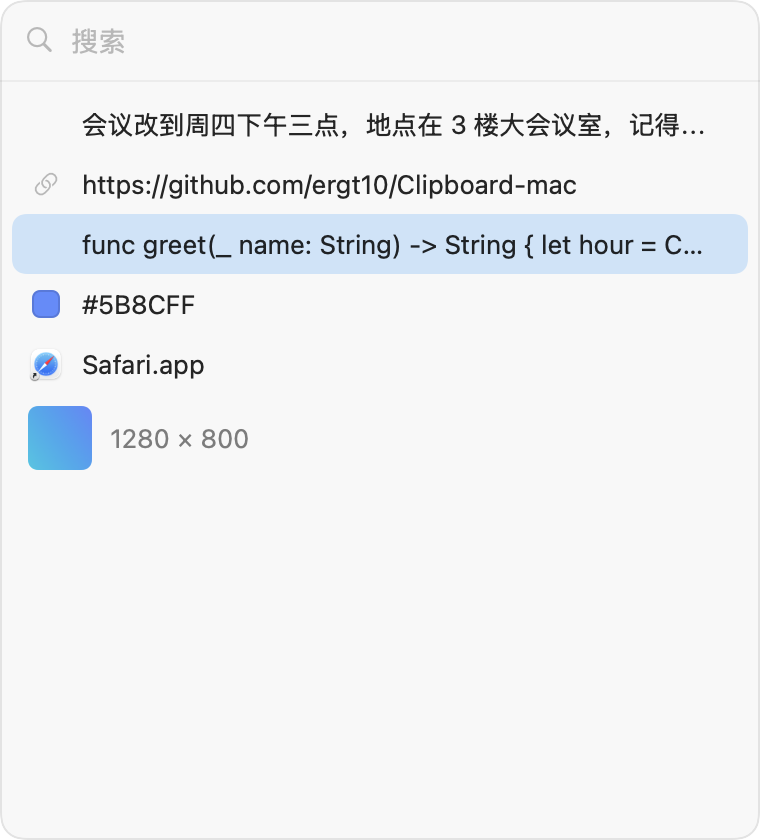
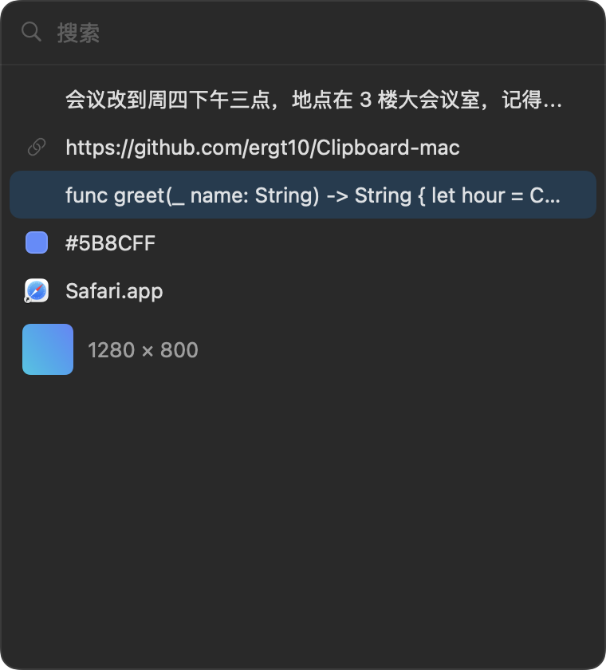

# Clip

一个美观、简洁、好用的 macOS 剪贴板历史工具。常驻菜单栏，按 **⌘⇧V** 呼出，搜索，单击或回车即可粘贴。

面板会在你正在输入的文字光标正下方弹出（下方放不下时改到上方；Chrome、Edge、Arc 等浏览器和 Electron App 也支持，Clip 会请它们开启辅助功能接口，第一次可能要稍等片刻面板才移到光标处）；如果当前 App 不提供光标位置，就在单行输入框下方弹出，再不行就在鼠标指针下方弹出。定位光标用的是辅助功能权限，没开权限时面板在鼠标指针下方弹出。




## 功能

- 自动记录复制过的**文本、图片和文件**，重复内容自动合并并移到最前。
- 小巧的单列列表，每条只显示内容本身；鼠标停在一条上会显示更完整的内容。
- 图片显示缩略图，文件显示图标，颜色值（如 `#5B8CFF`）显示色块。
- 即时搜索（多个关键词用空格分隔）；按 ⇥ 或右上角 ⋯ 按分类筛选：全部 / 文本 / 图片 / 文件 / 固定。
- 固定常用条目，固定的条目始终在最前，且不会被清理。
- 跳过密码管理器标记为“机密”或“临时”的内容（`org.nspasteboard.ConcealedType` 等）。
- 默认保留最近 500 条（含已固定条目）。超过 5 MB 的文本和超过 4000 万像素的图片不记录。
- 历史记录只保存在本机：`~/Library/Application Support/Clip/`，不会上传。注意：选中一条历史回贴时，它会重新写入系统剪贴板，开启“接力”时系统可能同步到你的其他设备；该目录也会随时间机器等备份一起备份。
- 只有直接从剪贴板复制、没有被密码管理器标记的内容才会被跳过；在终端等地方手动复制的密码、令牌仍会被记录。复制敏感内容前可以在菜单栏选择“暂停记录”（暂停状态会被记住，恢复时暂停期间复制的内容不会补记）。
- 菜单栏可暂停记录、设置登录时启动、清空历史。

## 快捷键

| 按键 | 作用 |
| --- | --- |
| ⌘⇧V | 呼出 / 收起面板 |
| ↑ ↓ | 选择条目 |
| ↩ | 粘贴到当前 App |
| ⌘↩ | 只复制，不粘贴 |
| ⌘1 … ⌘9 | 直接粘贴第 1–9 条 |
| ⌘P | 固定 / 取消固定 |
| ⌘⌫ | 删除条目 |
| ⇥ / ⇧⇥ | 切换分类 |
| Esc | 清空搜索；再按一次关闭 |
| ⌘Q | 退出 Clip |

单击条目直接粘贴；右键有更多操作。

## 安装

1. 从 [Releases](https://github.com/ergt10/Clipboard-mac/releases) 下载 `Clip.dmg`（或 `Clip.zip`），把 Clip 拖进“应用程序”。
2. App 没有 Apple 开发者签名和公证，首次打开会提示“Apple 无法验证……”。任选一种方式放行（只需一次）：
   - 终端执行 `xattr -dr com.apple.quarantine /Applications/Clip.app`，再打开；或
   - 先双击打开并在提示框点“完成”，然后到“系统设置 → 隐私与安全性”底部点“仍要打开”。
3. 第一次按回车粘贴时，系统会请求**辅助功能**权限（系统设置 → 隐私与安全性 → 辅助功能，打开 Clip）。没有这个权限时，回车只会把内容复制到剪贴板，需要自己按 ⌘V。

从旧版 ClipNest 升级：先退出并删除 ClipNest，再安装 Clip。Clip 第一次启动时会自动接管 ClipNest 的历史记录。

需要 macOS 14 或更高版本，支持 Apple 芯片和 Intel。

## 退出与卸载

Clip 没有 Dock 图标，退出它的方式有：

- 菜单栏图标 →“退出 Clip”；
- 面板里按 ⌘Q，或点右上角的 ⋯ →“退出 Clip”；
- 菜单栏图标被刘海或其他图标挡住时，在“应用程序”里再双击 Clip，会直接弹出面板。

卸载：菜单栏图标或面板右上角 ⋯ →“卸载 Clip…”。它会退出、取消登录时启动、把 App 移到废纸篓，并可选择把历史数据（`~/Library/Application Support/Clip/`）一起移到废纸篓。

## 从源码构建

只需要 Xcode Command Line Tools：

```bash
./build.sh            # 生成 build/Clip.app
./build.sh --release  # 额外生成 build/Clip.zip 和 build/Clip.dmg
```

源码在 `Sources/`：`Store.swift` 负责历史存储，`Pasteboard.swift` 负责监听剪贴板、写回和全局快捷键，`Views.swift` 是界面，`Panel.swift` 是浮动面板和键盘操作。

## 许可

MIT
